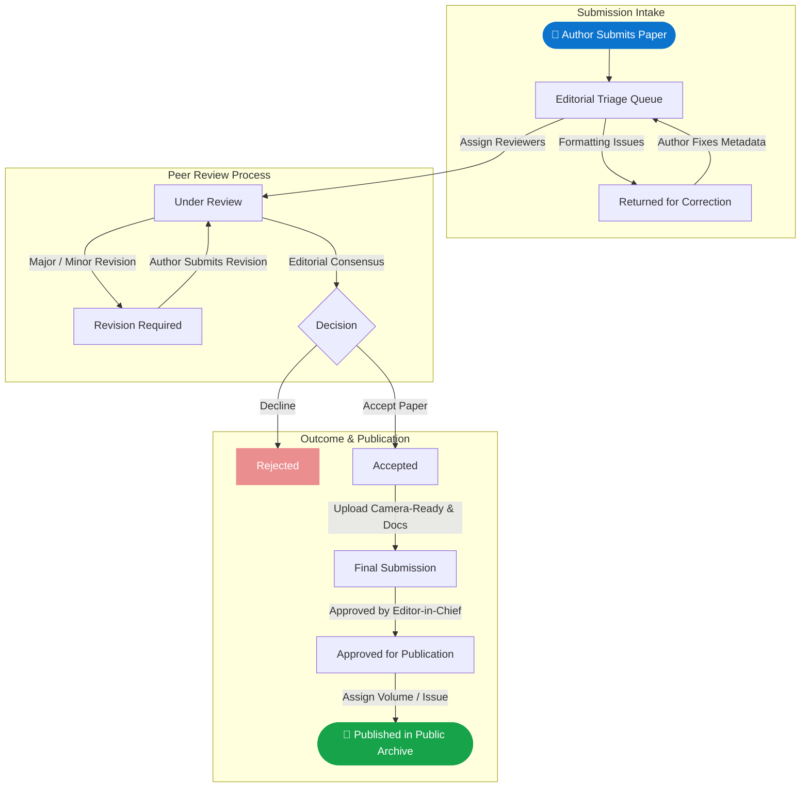

<div align="center">


# Journal of Emerging Research and Innovation (JERI)
### 🏛️ Sir Padampat Singhania University (SPSU), Udaipur

**A production-grade, peer-reviewed, open-access academic publishing platform.**  
Engineered end-to-end with an open public journal portal, an authenticated author submission console, and an editorial management workspace powered by Supabase, Cloudflare R2, and Deno Edge Functions.

<br />

[](https://jeri-spsu.co.in)
[](https://react.dev)
[](https://www.typescriptlang.org)
[](https://vitejs.dev)
[](https://supabase.com)
[](https://www.cloudflare.com/developer-platform/r2/)
[](https://tailwindcss.com)

</div>

---

## 🌟 Executive Overview

**JERI (Journal of Emerging Research and Innovation)** is a multidisciplinary, peer-reviewed scientific journal dedicated to publishing cutting-edge advancements across Engineering, Artificial Intelligence, Science, and Technology. 

This repository contains the complete codebase powering the journal's official operations:
- 🌐 **Public Open-Access Archive**: Browsable issue archives, volume explorer, paper abstracts, editorial guidelines, and contact channels.
- ✍️ **Author Workspace**: Streamlined three-phase submission pipeline (Initial, Revision, Camera-ready Final) with version history and live review feedback.
- ⚖️ **Editorial & Reviewer Control Panel**: Comprehensive double-blind peer-review state machine, reviewer assignments, editorial decisions with file annotations, user role management, and transactional email logs.

---

## ⚡ Key Highlights & Architecture

### 🛡️ Double-Blind Peer Review State Machine
- Strict role-based isolation: Reviewer identities are protected server-side and never exposed to authors via API or notifications.
- Formal status progression:
  $$\text{New Submission} \longrightarrow \text{Under Review} \longrightarrow \begin{cases} \text{Revision Required} \longleftrightarrow \text{Revised} \\ \text{Accepted} \longrightarrow \text{Final Submission} \longrightarrow \text{Published} \\ \text{Rejected} \end{cases}$$
- Pre-review correction loop (`RETURNED_FOR_CORRECTION`) allows authors to fix formatting and metadata without consuming one of their 3 revision attempts.

### 📝 Precision Submission Workflow
- **New Submission**: Collects manuscript metadata, up to 6 co-authors with affiliations, designated corresponding author, and Word manuscript files.
- **Revised Submission**: Looked up securely by Manuscript ID and registered author email, providing automated version tracking.
- **Final Submission**: Collects camera-ready copy, executed copyright transfer agreement, and proof of publication fee payment.

### 💬 Markdown Reviewer Feedback & File Annotations
- Editors compose rich structured feedback with formatting (bold, italics, bullet points, headers).
- Supports file attachments (e.g. annotated manuscripts or critique PDFs) delivered with secure, expiring pre-signed Cloudflare R2 download links.

### 🔔 Live In-App Notifications
- Real-time unread notification badge in the author and admin navigation headers.
- Direct deep-links to specific manuscript reviews and editorial status updates.

### 📬 Transactional Email Delivery Engine
- Branded transactional emails dispatched on every lifecycle event (welcome, submission received, revisions requested, decisions reached).
- Embedded high-resolution logo via inline MIME CID attachments (avoids aggressive Gmail image stripping).
- Complete delivery log audit table in the Admin dashboard with raw rendered HTML preview inspection.

---

## 🛠️ Technology Stack

| Ecosystem | Technology | Purpose |
| :--- | :--- | :--- |
| **Frontend Framework** | React 19 + TypeScript 5 | Reactive, strongly typed component architecture |
| **Bundler & Tooling** | Vite 6 | Lightning-fast HMR and optimized production bundling |
| **Styling & Design** | Tailwind CSS v4 + Radix UI | Modern responsive glassmorphism, bespoke color design tokens |
| **Animation & Icons** | Framer Motion + Lucide React | Micro-animations and unified iconography |
| **Backend & Database** | Supabase (PostgreSQL 15) | Relational persistence, Row-Level Security (RLS), and database triggers |
| **Serverless Compute** | 18 Deno Edge Functions | Isolated TypeScript microservices for auth, transitions, and mailers |
| **Asset Storage** | Cloudflare R2 | S3-compatible, zero-egress bucket storage via `aws4fetch` |
| **Email Transport** | Hostinger Business SMTP | High-deliverability transactional messaging with `denomailer` |

---

## 📂 Project Organization

```text
JERI_Journal-of-Emerging-Research-and-Innovation/
├── frontend/                          # React 19 Frontend Web Application
│   ├── public/                        # Static brand logos, favicons, and manifest
│   └── src/
│       ├── @types/                    # TypeScript data definitions & domain models
│       ├── auth/                      # Authentication context & session guards
│       ├── components/
│       │   ├── layouts/               # Public, Author, and Admin shell layouts
│       │   ├── shared/                # Status badges, notification bell, feedback editor
│       │   └── ui/                    # Base Radix & custom UI primitives
│       ├── configs/                   # Route tables, navigation config, and theme tokens
│       ├── services/supabase/         # Strongly typed database & Edge Function clients
│       └── views/
│           ├── public/                # Home, Archives, Author Guidelines, Editorial Board
│           ├── auth/                  # Sign In, Sign Up, Forgot/Reset Password
│           ├── author/                # Paper Submission form, My Submissions dashboard
│           └── admin/                 # Editorial triage, User management, Email delivery logs
│
├── backend/                           # Supabase Database & Serverless Functions
│   └── supabase/
│       ├── migrations/                # Versioned SQL migrations & authoritative schema
│       └── functions/                 # Deno serverless edge functions
│           ├── _shared/               # Auth guards, state machine, mailer engine, R2 client
│           ├── assign-reviewer/       # Reviewer allocation logic
│           ├── create-submission/     # Initial paper intake
│           ├── record-reviewer-decision/ # Editorial decision recording
│           ├── submit-revision/       # Revision uploads
│           ├── submit-final/          # Camera-ready manuscript & copyright submission
│           ├── publish/               # Issue release & paper publication
│           ├── send-test-email/       # Diagnostic email testing tool
│           └── delete-user/           # Admin account removal & cleanup
│
└── docs/                              # Architecture references and design documentation
```

---

## 🔄 Peer-Review State Machine



---

## 🚀 Getting Started

### Prerequisites
- **Node.js** (v18.x or newer) & **npm**
- **Supabase CLI** (optional, for local Edge Function testing)

### 1. Frontend Setup
```bash
# Clone the repository
git clone https://github.com/lakshhchopra/JERI_Journal-of-Emerging-Research-and-Innovation.git

# Navigate into the frontend workspace
cd JERI_Journal-of-Emerging-Research-and-Innovation/frontend

# Install dependencies
npm install

# Copy environment template and populate Supabase credentials
cp .env.example .env
```

Configure `frontend/.env`:
```env
VITE_SUPABASE_URL=https://your-project.supabase.co
VITE_SUPABASE_ANON_KEY=your-anon-key
```

Run the development server:
```bash
npm run dev
```
Open [http://localhost:5173](http://localhost:5173) in your browser.

### 2. Backend & Database Deployment
Deploying schema and edge functions to your Supabase project:
```bash
cd backend

# Link your remote Supabase instance
supabase link --project-ref your-project-id

# Apply the consolidated schema migration
supabase db push

# Deploy all 18 Deno Edge Functions
supabase functions deploy

# Set function secrets (SMTP credentials, Cloudflare R2 tokens)
supabase secrets set --env-file supabase/functions/.env.local
```

### 3. Production Build
```bash
cd frontend
npm run build
npm run preview
```

---

## 🔒 Security & Privacy Practices

- **Row-Level Security (RLS)**: Enforced across all PostgreSQL tables. Unauthenticated users can only query published manuscripts.
- **Server-Side Authorization**: Edge functions verify user JWTs and validate administrative credentials before executing workflow mutations.
- **Isolated Reviewers**: Identity masking guarantees single and double-blind integrity across all database views.
- **Hashed Password Reset**: High-entropy, single-use, 30-minute expiring tokens stored as SHA-256 hashes.

---

## 📜 Copyright & Governance

Published and maintained by **Sir Padampat Singhania University (SPSU)**, Udaipur, Rajasthan, India.  
All publication rights reserved. Open-access content licensed under standard academic fair-use and Creative Commons attribution guidelines.
