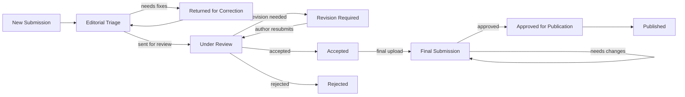

<div align="center">

# JERI
### Journal of Emerging Research and Innovation

**A peer-reviewed, open-access academic journal platform** — built end-to-end with a public
reading experience, an author submission portal, and an editorial admin console, running on a
real Supabase backend with Cloudflare R2 storage and transactional email.

[**Live Site → jeri-spsu.co.in**](https://jeri-spsu.co.in)

[](https://jeri-spsu.co.in)
[](https://react.dev)
[](https://www.typescriptlang.org)
[](https://supabase.com)
[](https://tailwindcss.com)

</div>

---

## What this is

JERI is a multidisciplinary, open-access scientific journal published by **Sir Padampat
Singhania University**, Udaipur. This repository is the full platform behind it: the public
marketing/archive site readers see, the portal authors use to submit and track manuscripts, and
the console the editorial team uses to run double-blind peer review from first submission
through to publication.

It isn't a demo with mock data — every workflow here (submission intake, reviewer rounds,
revisions, final camera-ready upload, publication) runs against a live Postgres database, real
file storage, and real outbound email.

## Highlights

- **Full peer-review state machine** — `Submitted → Under Review → Revision Required →
  Revised → Accepted → Final Submission → Approved → Published`, with a hard cap of 3 revision
  rounds and a pre-review "returned for correction" loop that doesn't burn a revision.
- **Double-blind by design** — reviewer identity never reaches the author, anywhere: not in the
  UI, not in notifications, not in the audit trail.
- **Three-stage author submission form** — New / Revised / Final Submission, each with exactly
  the fields the editorial office needs (manuscript metadata, co-authors, contact info, and the
  right file types per stage), looked up by Manuscript ID + registered email for revisions.
- **Rich reviewer feedback** — admins write decisions in a lightweight bold/italic/bullet editor
  and can attach a file (e.g. an annotated manuscript); both render identically in the app, in
  notifications, and in the email the author receives.
- **In-app notifications with a live unread count**, click-through straight to the relevant
  submission, for both authors and admins.
- **Admin console** — editorial triage queue, per-submission decision recording, user & role
  management, a full searchable/paginated email delivery log (every transactional email, with
  its exact rendered content viewable), and CSV export of the submissions table.
- **Public archive** — published issues and papers, gated strictly on final admin approval.
- **Branded transactional email** for every step of the pipeline, sent through a real SMTP
  mailbox and logged (sent/failed) for diagnosis.

## Tech stack

| Layer | Technology |
| --- | --- |
| Frontend | React 19, TypeScript, Vite, Tailwind CSS v4, react-router-dom, zustand, react-hook-form + zod |
| Backend | Supabase — Postgres, Row-Level Security, Auth, 18 Edge Functions (Deno) |
| File storage | Cloudflare R2 (S3-compatible, via `aws4fetch`) — manuscripts, revisions, reviewer attachments, copyright/payment files |
| Email | Hostinger Business Email over SMTP (`denomailer`), every send logged to Postgres |
| Hosting | Static frontend deployed to production at `jeri-spsu.co.in` |

## How it's organized

```text
.
├── frontend/                  React + TypeScript + Vite application
│   └── src/
│       ├── auth/               Session/auth context, Supabase-backed
│       ├── components/
│       │   ├── shared/          Status badges, notification bell, markdown feedback, dialogs…
│       │   └── ui/               Radix-based design system primitives
│       ├── services/supabase/  Typed client wrappers around tables + Edge Functions
│       ├── configs/            Routes, navigation, theme
│       └── views/
│           ├── public/          Home, archives, guidelines, editorial board, contact…
│           ├── auth/            Sign up / sign in / password reset
│           ├── author/          Paper Submission (New/Revised/Final), My Submissions
│           └── admin/           Control Panel, Submissions, Users, Email Log
│
└── backend/                   Supabase project (no server to deploy)
    └── supabase/
        ├── migrations/          Postgres schema + RLS, in order
        └── functions/
            ├── _shared/          Auth guard, state machine, R2 client, mailer, templates
            └── …                 create-submission, assign-reviewer, record-reviewer-decision,
                                   submit-revision, submit-final, final-approve, publish,
                                   set-user-role, delete-user, get-download-url, and more
```

## Core workflow at a glance



Every arrow above is a real Edge Function call, gated by server-side role checks and the
`statusTransitions.ts` state machine — the frontend never decides what's a legal transition.

## Running it locally

Requirements: Node.js, npm, and your own Supabase project (free tier works) if you want the
backend live rather than just reading the UI.

```bash
cd frontend
npm install
npm run dev
```

Vite serves the app at `http://localhost:5173`. Point `frontend/.env` at your own Supabase
project (`VITE_SUPABASE_URL`, `VITE_SUPABASE_ANON_KEY`) — see `frontend/.env.example`.

To stand up the backend yourself:

```bash
cd backend
supabase link --project-ref <your-project-ref>
supabase db push                     # applies every migration in order
supabase functions deploy            # deploys all Edge Functions
supabase secrets set --env-file supabase/functions/.env.local
```

Full setup details (SMTP, R2, secrets, and the manual verification checklist) live in
[`backend/README.md`](backend/README.md).

### Build

```bash
cd frontend
npm run build
npm run preview
```

## Access

- **Live site:** [jeri-spsu.co.in](https://jeri-spsu.co.in)
- **Source:** this repository
- Author and admin dashboards require a signed-in account; roles are assigned by an existing
  admin via `/admin/users` (or directly in the Supabase dashboard to bootstrap the first one).

## License

Published and maintained by Sir Padampat Singhania University, Udaipur. All rights reserved.
